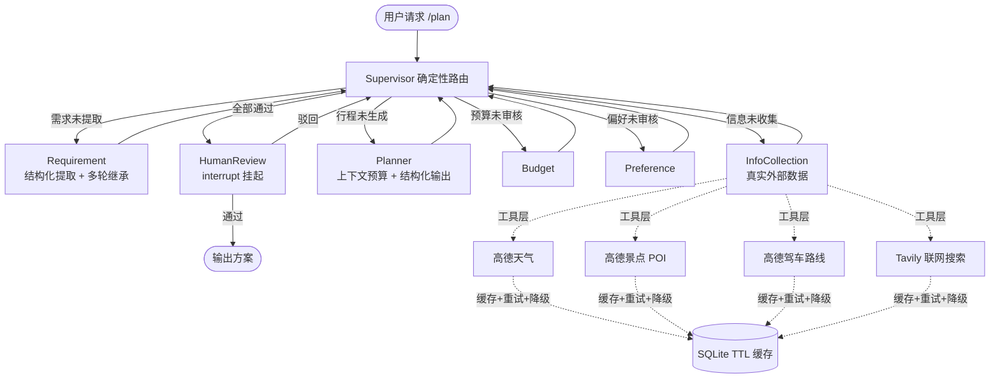

# 智能旅行规划助手 (Travel Planner Agent)

基于 LangGraph 的多 Agent 协作旅行规划系统。用户用自然语言输入目的地、日期、预算、偏好，系统自动完成**需求提取 → 真实信息收集 → 行程编排 → 预算与偏好审核 → 人工复核**，输出可直接执行的行程方案。

信息收集全部接入**真实数据源**（高德地图天气 / 景点 POI / 驾车路线 + Tavily 联网搜索），不是 Mock。

---

## ✨ 核心亮点

- **Supervisor 中心化（Hub-and-Spoke）多 Agent 架构**：中央 Supervisor 按全局状态做**确定性路由**，调度 5 个专职节点 + 1 个人工审核节点。路由零额外 token、可单测、失败可归因到具体节点。
- **真实外部数据接入**：高德地图（天气预报 / 景点 POI 检索 / 驾车距离时长）+ Tavily 联网搜索（门票预约、限流、当地活动等实时信息）。
- **确定性编排 + LLM 自主选工具（Function Calling）**：核心链路走确定性编排（可测、可控、成本固定），长尾信息交给模型用 `bind_tools` 自主决定搜什么——这是刻意的分工，而不是把一切交给模型。
- **多轮对话记忆**：结构化轮次摘要（每轮一行）+ 有界消息历史 + **增量字段继承**。用户说"改成 5 天，预算加到 8000"，目的地与偏好会从上一轮继承，只更新改动部分。
- **上下文预算管理**：token 估算（保守启发式，不引入 tiktoken）+ 分块优先级截断——用户需求/天气/景点必须完整，历史与联网摘要预算不足时先被截断，避免长对话把上下文撑爆。
- **弹性工具层**：TTL 缓存（命中率在 `/metrics` 可观测）→ 指数退避重试（默认 3 次）→ 失败降级为兜底文案，外部依赖挂掉不会掐断整条规划链路。
- **生产级 Human-in-the-loop**：`interrupt()` 挂起 + `Command(resume=...)` 恢复，支持"预算超支 → 人工复核 → 驳回重规划"闭环（业务迭代上限 3 轮 + 图递归上限兜底）。
- **状态持久化**：LangGraph Checkpointer（SQLite + WAL）按 `thread_id` 落盘，服务重启后可续跑、不丢会话。
- **全链路可观测**：`trace_id` 中间件 + `/metrics`（请求数/错误数/平均延迟/缓存命中率）+ LangSmith 追踪。

---

## 🏗️ 架构



### 工具层设计（`app/tools/`）

| 模块 | 作用 |
| :--- | :--- |
| `amap.py` | 高德 Web 服务封装：地理编码、天气、景点 POI、驾车路线；路线按相邻景点串链，限制最大段数避免 N² 调用 |
| `search.py` | Tavily 联网搜索，结果整理成提示词友好文本 |
| `cache.py` | SQLite TTL 缓存（按 namespace 分 TTL），带命中率统计 |
| `registry.py` | 把内部工具包装成 LangChain Tool，供模型 Function Calling 调用 |
| `app/utils/resilience.py` | 指数退避重试 + 降级封装 |
| `app/utils/context.py` | token 估算、分块预算分配、结构化历史摘要 |

---

## 🧠 上下文与记忆设计

多轮对话的真实问题是：历史 + 工具返回会随轮次线性膨胀，导致上下文撞顶、成本失控、延迟上升。本项目的三处设计：

1. **State 层有界**：`messages` 与 `tool_results` 使用 `append_bounded(N)` reducer（拼接后只保留最近 N 条），而不是无界的 `operator.add`。
2. **结构化摘要替代 LLM 摘要**：每轮压成一行（目的地/天数/预算/产出/人工反馈），零 token 成本、可复现、可单测，且不会像自由摘要那样漂移。
3. **分块优先级截断**：`assemble_context()` 按 `user_needs > weather > attractions > route > search > history` 分配 token 预算，低优先级块先被截断。

**增量继承**：`/plan` 在同一 `thread_id` 上续接时，把上一轮字段放进 `previous_extraction` 交给需求节点，由模型判断用户这轮改了哪些字段——注意**不能预填进 `destination`/`days`**，否则 Supervisor 会认为需求已提取而跳过需求节点，用户的修改会被静默忽略（这是实现多轮时最容易踩的坑）。

---

## 🛡️ 可靠性设计

| 层次 | 机制 | 说明 |
| :--- | :--- | :--- |
| 缓存 | TTL 按数据特性分档 | 地理编码 7 天 / 天气 1 小时 / 景点与路线 1 天 / 搜索 6 小时 |
| 重试 | 指数退避（0.5s → 1s → 2s，上限 4s） | 默认 3 次重试（共 4 次尝试），可通过 `TOOL_RETRY_TIMES` 调整 |
| 降级 | 重试耗尽后返回兜底值 | 天气失败 → "按季节常识准备"；景点为空 → 提示模型按通用知识规划；路线失败 → 建议自行导航 |
| 兜底 | 模型未补充检索时走确定性搜索 | 保证 `search_info` 不为空，演示不出现空洞 |
| 中断恢复 | `interrupt()` + `Command(resume=...)` | 审核驳回回到 Supervisor 重规划，业务迭代与图递归双重上限 |
| 存储 | SQLite WAL + `busy_timeout` | 读写并发不互相阻塞，写锁冲突等待而非直接报错 |

---

## 🚀 快速开始

```bash
git clone https://github.com/jiage-agent/TravelPlannerAgent.git
cd TravelPlannerAgent
uv sync
cp .env.example .env
# 编辑 .env，至少填入：DEEPSEEK_API_KEY、AMAP_API_KEY、API_KEY
# 可选：TAVILY_API_KEY（联网补充）、DASHSCOPE_API_KEY（多模型切换）、LANGCHAIN_API_KEY（LangSmith 追踪）
uv run uvicorn app.main:api --reload --port 8000
```

打开 `http://127.0.0.1:8000/docs` 查看 Swagger 文档。

---

## 📡 API 一览

| 方法 | 路径 | 说明 |
| :--- | :--- | :--- |
| GET | `/health` | 健康检查 |
| GET | `/metrics` | 请求数 / 错误数 / 平均延迟 / 工具缓存命中率 |
| POST | `/plan` | 发起规划（跑到人工审核前挂起）；同 `thread_id` 再次调用即多轮续接，`new_session=true` 开新会话 |
| POST | `/resume` | 人工审核后恢复执行（`通过` 或修改意见） |
| GET | `/sessions/{thread_id}` | 查询会话状态与最终方案 |
| GET | `/sessions/{thread_id}/context` | **查看当前上下文里到底存了什么**（轮次/摘要 token/消息数/继承字段） |
| DELETE | `/sessions/{thread_id}` | 清空会话 |
| DELETE | `/cache` | 清理工具缓存（演示前强制走真实请求） |

所有接口需在 Header 中携带 `X-API-Key`。

### 多轮对话示例

```bash
# 第 1 轮：新会话
curl -X POST http://127.0.0.1:8000/plan -H "X-API-Key: $API_KEY" -H "Content-Type: application/json" \
  -d '{"user_query":"我想10月20号去北京玩3天，预算5000，喜欢历史和美食","thread_id":"demo","new_session":true}'

# 第 2 轮：同一 thread_id 续接 —— 目的地与偏好继承上一轮，只更新天数与预算
curl -X POST http://127.0.0.1:8000/plan -H "X-API-Key: $API_KEY" -H "Content-Type: application/json" \
  -d '{"user_query":"改成5天，预算加到8000","thread_id":"demo"}'

# 人工审核
curl -X POST http://127.0.0.1:8000/resume -H "X-API-Key: $API_KEY" -H "Content-Type: application/json" \
  -d '{"thread_id":"demo","user_feedback":"通过"}'
```

---

## 🔧 技术栈

- **框架**：LangGraph 1.2（StateGraph / Checkpointer / interrupt）、LangChain 1.4
- **LLM**：DeepSeek Chat（默认），支持阿里云百炼 qwen-plus 配置化切换
- **结构化输出**：Pydantic 2.13 + `with_structured_output(method="json_mode")`
- **外部数据**：高德地图 Web 服务、Tavily 联网搜索
- **Web**：FastAPI + Uvicorn（含 trace_id 中间件与全局异常处理）
- **状态与缓存**：SQLite（Checkpointer + 业务库 + 工具 TTL 缓存，WAL 模式）
- **可观测性**：LangSmith + `/metrics` + 结构化日志
- **依赖管理**：uv（含 `uv.lock` 锁定）

---

## 📊 评估结果

评测集：**50 条**需求提取用例（34 条正向 / 16 条边界与非法），从 8 条逐步迭代至 50 条（每轮把失败样例补入数据集）。
评测脚本：`tests/evaluation/requirement_collection/requirement_eval_agent_v2.py`，完整报告见 `eval_report_20261014.txt`。

**分母拆分**：只统计"用户实际提到的字段"，把"没提也算对"的平凡正确项从分母中剔除，并单列拒答正确率。

| 子集 | 结构化输出合规率 | 目的地 | 天数 | 预算 | 偏好 F1 | 样本级全对 |
| :--- | :--- | :--- | :--- | :--- | :--- | :--- |
| 综合（50） | 50/50 = 100% | 41/42 = 97.6% | 32/32 = 100% | 25/25 = 100% | 50/58 = 86.2% | 43/50 = 86.0% |
| 正向（34） | 34/34 = 100% | 29/30 = 96.7% | 26/26 = 100% | 19/19 = 100% | 46/49 = 93.9% | 31/34 = 91.2% |
| 负向（16） | 16/16 = 100% | 12/12 = 100% | 6/6 = 100% | 6/6 = 100% | 4/9 = 44.4% | 12/16 = 75.0% |

- **偏好 P/R/F1**（micro，元素级）：综合 P 80.6% / R 92.6% / F1 86.2%；正向 F1 93.9%；另有 25 条"期望空且输出空"的空集正确不计入 F1。
- **未提及字段的拒答正确率**（期望返回默认值）：目的地 8/8、天数 18/18、预算 25/25、偏好 25/28 = 89.3%。
- **负样例按期望行为分类**：非法表达 3/4、越界/不合理 4/4、境外目的地 2/3、其他 3/5。

**失败样本归因**：逐条复盘后确认，多数失败不是模型能力问题，而是**评测集自身的标注偏差与字面匹配误判**（例如"铁塔"与"埃菲尔铁塔"被判为不匹配、"西北大环线"被判与"西北"不等、否定表达"讨厌海边"被计入偏好），已据此修正判定规则。
**口径演进**：v2.0 用集合交集判偏好（命中 1 个就算对，指标虚高），v2.1 改为 precision / recall / F1，并把"没提也算对"的平凡正确项从分母中剔除。

> ⚠️ 上述为**单次运行**结果。同一脚本重复运行会有约 ±3 个百分点的波动（LLM 采样随机性），比较不同 Prompt 版本时应在同一批次内对比。

### 运行时观测（本机实测）

| 指标 | 数值 | 说明 |
| :--- | :--- | :--- |
| 单轮冷启动耗时 | 约 13 s | 含 10 次外部调用（天气/POI/路线/搜索）+ 5 次 LLM 调用 |
| 第二轮耗时 | 约 8.5 s | 工具缓存命中，重复城市查询不再打外部 API |
| 缓存命中率 | 85.7% | 同一会话第二轮起 `/metrics` 实测值 |

---

## 📅 版本演进

| 版本 | 时间 | 变更 |
| :--- | :--- | :--- |
| v1.0 | 2026.06 | 线性流水线，跑通基础链路 |
| v2.0 | 2026.10 | 重构为 Supervisor 中心化架构；新增信息收集节点、Pydantic 强校验、Human-in-the-loop、请求追踪中间件与 `/metrics` |
| v2.1 | 2026.10 | 路线 Mock → 高德真实数据（天气/景点/驾车路线）；接入 Tavily 联网搜索与 LLM Function Calling；新增工具层（缓存 / 重试 / 降级）；实现多轮记忆与上下文预算管理；评测口径改造（分母拆分 + precision/recall） |

---

## 📋 TODO

- [ ] Docker 一键部署（Dockerfile + docker-compose）
- [ ] 升级为 `AsyncSqliteSaver` + 异步 Agent，支持高并发（当前同步 `stream()` 会阻塞事件循环）
- [ ] 部署到公网供在线体验（魔搭创空间 / Hugging Face Spaces）
- [ ] 前端体验优化（Chainlit 已可用，静态页待同步新字段）

## 📄 License

MIT
