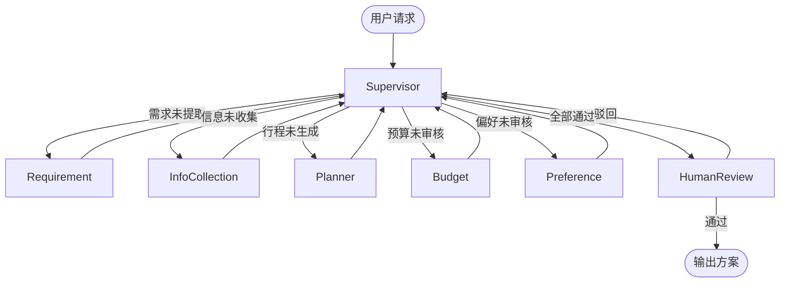

# 智能旅行规划助手 (Travel Planner Agent)

基于 LangGraph 的多 Agent 协作旅行规划系统。用户用自然语言输入目的地、日期、预算、偏好，系统自动完成需求提取、实时天气获取、行程编排、预算与偏好审核，并通过 Human-in-the-loop 人工复核后输出可执行方案。

## ✨ 核心亮点

- **Supervisor 中心化（Hub-and-Spoke）多 Agent 架构**：中央 Supervisor 动态调度 5 个子 Agent（需求、信息、规划、预算、偏好）
- **Pydantic 强校验的结构化输出**：所有 LLM 输出均通过 `with_structured_output` + Pydantic 校验，杜绝 JSON 解析崩溃
- **真实外部信息接入**：通过 `httpx` 调用 `wttr.in` 获取目的地真实天气
- **生产级 Human-in-the-loop**：基于 `interrupt()` + `Command(resume=...)` 实现工作流挂起与人工恢复
- **状态持久化**：LangGraph Checkpointer（SQLite）实现断点续跑，业务数据独立落库
- **全链路可观测**：LangSmith 追踪每一次 LLM 调用与节点执行

## 🏗️ 架构



## 🚀 快速开始

```bash
git clone https://github.com/jiage-agent/TravelPlannerAgent.git
cd TravelPlannerAgent
uv sync
cp .env.example .env
# 编辑 .env，填入 DEEPSEEK_API_KEY 与 API_KEY
uv run uvicorn app.main:api --reload --port 8000
```

打开 `http://127.0.0.1:8000/docs` 查看 Swagger 文档。

## 📡 API 一览

| 方法 | 路径 | 说明 |
| :--- | :--- | :--- |
| GET | `/health` | 健康检查 |
| POST | `/plan` | 发起规划（跑到人工审核前挂起） |
| POST | `/resume` | 人工审核后恢复执行 |
| GET | `/sessions/{thread_id}` | 查询会话状态与最终方案 |
| DELETE | `/sessions/{thread_id}` | 清空会话 |

所有接口需在 Header 中携带 `X-API-Key`。

## 🔧 技术栈

- **框架**：LangGraph 1.2、LangChain 1.4
- **LLM**：DeepSeek Chat
- **结构化输出**：Pydantic 2.13 + `json_mode`
- **Web**：FastAPI + Uvicorn
- **状态持久化**：SQLite（Checkpointer + 业务库）
- **可观测性**：LangSmith
- **依赖管理**：uv

## 📊 评估结果

- 结构化输出合规率：待补充
- 需求提取准确率：待补充

## 📅 版本演进

| 版本 | 时间 | 变更 |
| :--- | :--- | :--- |
| v1.0 | 2026.06 | 线性流水线，跑通基础链路 |
| v2.0 | 2026.10 | 重构为 Supervisor 中心化架构，新增信息收集节点、Pydantic 强校验、Human-in-the-loop |

## 📋 TODO

- [ ] 接入高德/百度路线 API（替换当前 Mock 路线）
- [ ] 引入系统评估：自建评测集统计结构化输出合规率
- [ ] 升级为 `AsyncSqliteSaver` + 异步 Agent，支持高并发
- [ ] Docker 一键部署
- [ ] Chainlit 前端演示

## 📄 License

MIT